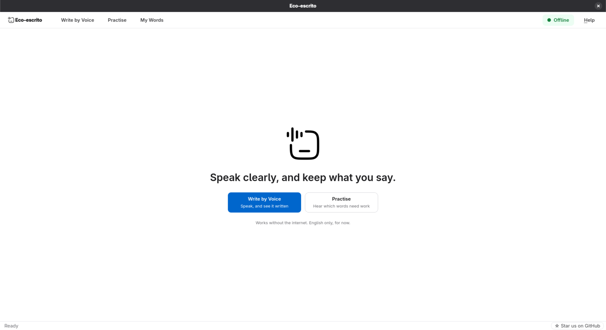

# Eco-escrito

**Speak clearly, and keep what you say.**
Eco-escrito writes down what you say and helps you pronounce English better,
entirely on your own computer. It needs no internet, no account and no
subscription, and nothing you say ever leaves the machine. English only, for
now.

The name is the idea: *eco* (echo) and *escrito* (written), so your voice,
echoed in writing.


[](LICENSE)
[](https://github.com/2musime/eco-escrito)



## Who it helps

Anyone, of any age, anywhere, including places with slow, costly or no internet:

- **A child or a new learner practising English sounds**, told which word to try
  again, privately, with no score to fear.
- **An older person, or anyone who finds typing hard**, writing a letter or a
  note just by speaking.
- **A student, journalist, nurse or lawyer** whose notes must not go to someone
  else's server.
- **Anyone offline:** on a plane, in a village classroom, or wherever mobile
  data is too expensive.

## Features

- **Write by Voice:** speak, and see it written. Words appear as you talk.
- **Practise:** read a sentence aloud and see which words came through, with the
  one word to try next.
- **My Words:** everything you have said, its text and recording together. Play,
  copy, save or delete it.

Fully offline and private by default: every build checks that the program
contains no network code. See [docs/PRIVACY.md](docs/PRIVACY.md).

## Install

**Windows:** download the installer from the
[latest release](https://github.com/2musime/eco-escrito/releases/latest), run
it, and open **Eco-escrito** from the Start Menu. The speech model is included.

**Fedora:**

```bash
sudo dnf install ./eco-escrito-*-Linux.rpm
eco-escrito-install-model base.en --user
```

Requirements, other models, upgrading and uninstalling: [INSTALL.md](INSTALL.md).
To build it yourself: [CONTRIBUTING.md](CONTRIBUTING.md).

## Get started

Open **Eco-escrito**. Choose **Write by Voice** or **Practise**, press **Start
Speaking**, and talk. What you say is kept under **My Words**.

## Documentation

| Topic | Document |
|---|---|
| Installing, requirements, limitations | [INSTALL.md](INSTALL.md) |
| The interface and keyboard shortcuts | [docs/GRAPHICAL_INTERFACE.md](docs/GRAPHICAL_INTERFACE.md) |
| Pronunciation practice | [docs/PRACTICE.md](docs/PRACTICE.md) |
| Command line | [docs/CLI.md](docs/CLI.md) |
| Privacy | [docs/PRIVACY.md](docs/PRIVACY.md) |
| Where files go | [docs/FILE_STORAGE.md](docs/FILE_STORAGE.md) |
| Performance and hardware | [docs/PERFORMANCE.md](docs/PERFORMANCE.md) |
| Building, on Linux and Windows | [docs/BUILDING.md](docs/BUILDING.md) |
| Contributing, tests, project layout | [CONTRIBUTING.md](CONTRIBUTING.md) |

More design notes are in [docs/](docs/): audio capture, streaming, noise
reduction, models, error handling, testing, quality gates and releasing.

## Author

Made by **David TUMUSIME**, who loves building useful things with technology:
[GitHub](https://github.com/2musime) ·
[Instagram](https://www.instagram.com/2musime).

If Eco-escrito is useful to you, please
[star it on GitHub](https://github.com/2musime/eco-escrito). It helps other
people find it.

## License

Released under the [MIT License](LICENSE). Copyright (c) 2026 David TUMUSIME.

Built on [whisper.cpp](https://github.com/ggml-org/whisper.cpp) (MIT) with
[OpenAI Whisper](https://github.com/openai/whisper) models,
[miniaudio](https://miniaud.io/) (public domain or MIT-0), and
[Qt 6](https://www.qt.io/) (LGPL v3).
